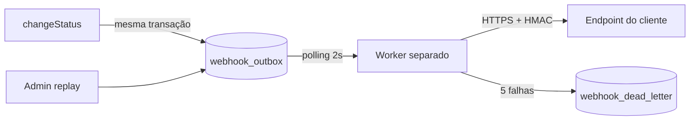

# RFC — Request for Comments

## Metadados

| Campo | Valor |
|---|---|
| Título | Sistema de Webhooks de Notificação de Pedidos |
| Autor | Larissa (Tech Lead), conforme [09:50] |
| Status | Em revisão |
| Data | 2026-11-23 |
| Revisores | Bruno (Pedidos), Diego (Plataforma), Sofia (Segurança), Marcos (PM) |

## 1. Resumo executivo (TL;DR)

Propomos notificar clientes B2B, via webhook HTTPS, sempre que o status de um pedido mudar. O evento é gravado em uma tabela `webhook_outbox` **na mesma transação** de `OrderService.changeStatus`; um **worker em processo separado** faz polling a cada 2 s, assina o payload com HMAC-SHA256 e entrega com garantia **at-least-once**. Falhas seguem backoff exponencial de 5 tentativas e, depois, vão para uma DLQ com replay manual por ADMIN. Sem infraestrutura nova: apenas MySQL, Prisma e os padrões já existentes. Prazo estimado: 3 sprints, incluindo a revisão de segurança.

## 2. Contexto e problema

Atlas Comercial, MaxDistribuição e Nova Cargo pediram notificação "em tempo real" (qualquer valor abaixo de 10 s serve) e hoje fazem polling em `GET /orders`, o que torna a integração lenta e cara [09:00 Marcos, 09:02 Marcos]. A Atlas condicionou a permanência à entrega até o fim do trimestre [09:00 Marcos].

A aplicação não possui nenhum mecanismo de notificação externa. A mudança de status ocorre em uma transação já pesada (atualiza `orders`, insere em `order_status_history` e ajusta estoque) em `src/modules/orders/order.service.ts` [09:04 Bruno], então chamar o cliente dentro dela acoplaria a latência externa ao fluxo de pedidos. O escopo é apenas **saída** (nós para o cliente) [09:02 Marcos].

## 3. Proposta técnica

Visão geral (o detalhamento de implementação está no FDD):

1. **Outbox transacional.** `changeStatus` chama `publishWebhookEvent(tx, ...)`, que grava o evento já renderizado (snapshot) para cada webhook ativo interessado no status. Se a gravação falhar, a mudança de status sofre rollback. ([ADR-001](adrs/ADR-001-outbox-no-mysql.md), [ADR-007](adrs/ADR-007-snapshot-do-payload-e-publish-webhook-event.md))
2. **Worker separado.** Novo entry-point `src/worker.ts`, polling de 2 s, single-worker, com `PrismaClient` próprio. ([ADR-005](adrs/ADR-005-worker-separado-em-polling.md))
3. **Entrega confiável.** At-least-once; `X-Event-Id` permite deduplicação pelo cliente; ordenação apenas por `order_id`. ([ADR-004](adrs/ADR-004-at-least-once-com-x-event-id.md))
4. **Retry e DLQ.** 5 tentativas (1 min, 5 min, 30 min, 2 h, 12 h), timeout de 10 s, DLQ em tabela separada com replay via endpoint ADMIN. ([ADR-002](adrs/ADR-002-retry-backoff-e-dlq.md))
5. **Segurança.** HMAC-SHA256 do corpo, secret única por endpoint, rotação com grace de 24 h, URL `https` e payload limitado a 64 KB. ([ADR-003](adrs/ADR-003-hmac-sha256-secret-por-endpoint.md))
6. **Superfície de API.** CRUD de configuração de webhooks (qualquer role autenticada), `GET /webhooks/:id/deliveries` e replay de DLQ (ADMIN), no padrão modular existente. ([ADR-006](adrs/ADR-006-reuso-dos-padroes-do-projeto.md))

## 4. Alternativas consideradas

| Alternativa | Por que foi descartada (trade-off) |
|---|---|
| **Chamada HTTP síncrona em `changeStatus`** | Simples, mas um cliente lento ou offline travaria mudanças de status de outros pedidos, e um cliente fora do ar forçaria rollback [09:04 Bruno, 09:06 Diego]. |
| **Redis Streams ou fila externa** | Entrega desacoplada, porém exige subir e operar infraestrutura nova; overengineering para um time pequeno [09:07 Larissa/Diego]. |
| **Trigger de banco para acionar o worker** | Mais reativo em teoria, mas o MySQL não notifica processos externos; seria necessário improvisar [09:09 Diego]. Polling de 2 s cumpre o requisito de menos de 10 s. |
| **Retry indefinido** | Evita perder eventos, mas deixa eventos pendurados se o cliente sumir [09:15 Diego]. |
| **3 tentativas** | Mais agressivo, mas cobre só cerca de 30 min, menos que indisponibilidades já vistas (2 h) [09:16 Diego]. |
| **Exactly-once** | Melhor garantia, mas exige coordenação dos dois lados e é muito mais complexo [09:25 Diego]. |

## 5. Questões em aberto

1. **Rate limiting de saída:** 50 mudanças por minuto geram 50 chamadas ao cliente? Decisão: observar e implementar se virar problema [09:38–09:39 Diego/Larissa]. Pergunta: qual limiar indicaria necessidade?
2. **Escala para múltiplos workers:** a ordenação por `order_id` só vale com um worker; particionamento ou lock pessimista ficam como "problema do futuro" [09:12–09:13 Diego].
3. **Alerta ao cliente com webhook falhando (e-mail):** fora desta fase; reavaliar depois de medir o impacto [09:37 Larissa].
4. **Arquivamento de eventos entregues** (cerca de 30 dias): citado como fora do escopo, sem política definida [09:08 Diego].
5. **Armazenamento da secret** (necessariamente recuperável para assinar) e a revisão de HMAC/geração de secret: a definir com a Sofia, que reservou 2 dias úteis antes do deploy [09:46 Sofia]. Esta é uma inferência deste RFC, não um ponto levantado explicitamente.

Fora de escopo, já descartado: dashboard visual para o cliente, que é projeto do time de frontend [09:40 Larissa].

## 6. Impacto e riscos

**Impacto**
- `changeStatus` ganha um INSERT na outbox dentro da transação; o arquivo `src/modules/orders/order.service.ts` é a única alteração em módulo existente, além do registro de rotas em `src/routes/index.ts`.
- Novos: módulo `src/modules/webhooks`, `src/worker.ts`, script `npm run worker`, tabelas `webhook_outbox`, `webhook_dead_letter` e de configuração de webhooks.
- Operação: um segundo processo para monitorar.

**Riscos**

| Risco | Mitigação proposta |
|---|---|
| Falha na outbox derruba a mudança de status | Intencional [09:40 Bruno]; cobrir com testes ponta a ponta. |
| Entregas duplicadas | At-least-once com `X-Event-Id`; documentar no portal de desenvolvedor [09:26 Marcos]. |
| Vazamento de secret | Secret por endpoint e rotação com grace de 24 h [09:21–09:22 Sofia]. |
| Crescimento da outbox e carga de polling | Índices em `status` e `created_at`; lotes pequenos [09:08 Diego]. |
| Prazo (fim de novembro para a Atlas) | Estimativa de 3 sprints, que deve ser confrontada com a data pedida [09:45–09:47]. |

## 7. Decisões relacionadas

| ADR | Tema |
|---|---|
| [ADR-001](adrs/ADR-001-outbox-no-mysql.md) | Outbox no MySQL |
| [ADR-002](adrs/ADR-002-retry-backoff-e-dlq.md) | Retry com backoff e DLQ |
| [ADR-003](adrs/ADR-003-hmac-sha256-secret-por-endpoint.md) | HMAC-SHA256, secret por endpoint e rotação |
| [ADR-004](adrs/ADR-004-at-least-once-com-x-event-id.md) | At-least-once com `X-Event-Id` |
| [ADR-005](adrs/ADR-005-worker-separado-em-polling.md) | Worker separado em polling |
| [ADR-006](adrs/ADR-006-reuso-dos-padroes-do-projeto.md) | Reuso dos padrões do projeto |
| [ADR-007](adrs/ADR-007-snapshot-do-payload-e-publish-webhook-event.md) | Snapshot do payload e `publishWebhookEvent` |

O detalhamento de contratos, fluxos, erros `WEBHOOK_*` e integração com o código está no [FDD](FDD.md).
